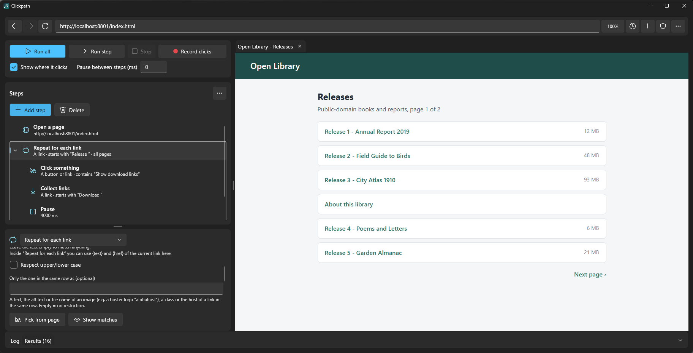
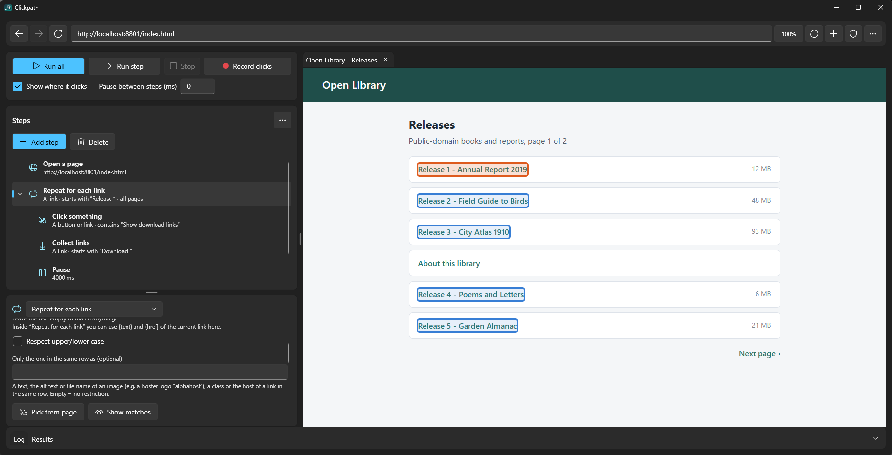
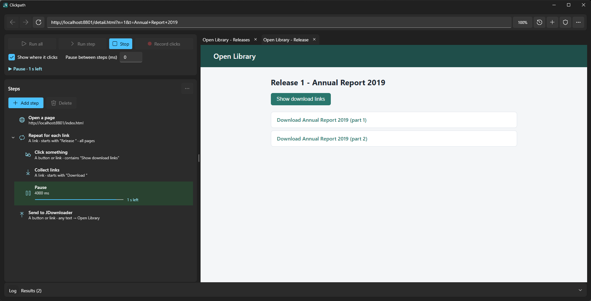
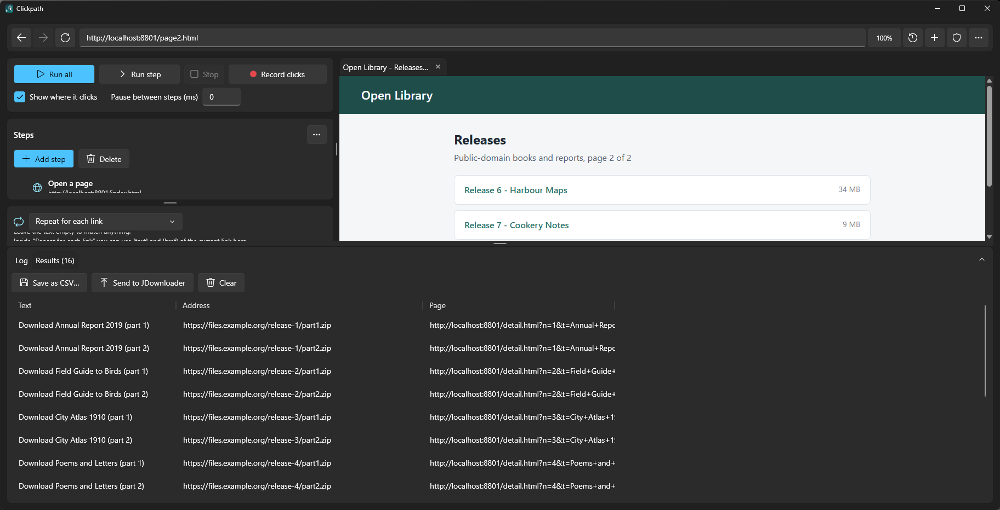

<p align="center"></p>

# Clickpath

**Record a click-through once, replay it automatically.** A Windows desktop tool for browser automation without writing code. Click
through a website once (or build the steps by hand), then replay the sequence automatically: open pages, click things, walk through lists and page after page of links, collect the
links and hand them to JDownloader.

Clickpath is a WPF application (.NET 10) with an embedded Chromium browser (WebView2). It finds things on a page by their **text**,
not by CSS selectors, so plans survive small changes to a site. Everything is a *step* in a tree; steps can be nested inside loops
and conditions.

## What you can do with it

- **Record** a click-through: switch on *Record clicks* and use the browser, every click becomes a step.
- **Build and edit** the plan as a tree: add and delete steps, **drag and drop** them to move or nest them (or Alt+arrow keys); open, save and clear the plan from the **"..."** menu; **drag and drop** steps (a group moves with all its
  steps); swap a group for another kind without losing its steps; save and open plans as JSON files.
- **Work off your own link list**: type, paste or collect addresses (one per line) and repeat steps for each of them. Right-click a link in the built-in browser and choose
  **Add to link list**: it goes into the selected link list, else the one used last, else the first in the plan.
- **Repeat for each link**: open every matching link in its own tab, run the steps below it, close the tab - over **all pages**
  of a paginated list (the "next" button is detected automatically) and optionally limited to a **range** (start and end link).
- **Block advertising with uBlock Origin**: downloaded automatically on the first start (into `%LocalAppData%\Clickpath\extensions`; delete the
  `ublock-origin` folder there to fetch a newer version). Switch it on with the shield button next to the address bar (or `--adblock on|off` on the command line). A right click on the
  shield opens uBlock's settings, filter lists, own filters and logger. Plans can behave differently with it on, so unattended runs should pin the switch.
- **See what a run is doing**: the step being executed is highlighted in the list (the list scrolls along), a status line under the
  playback buttons names it, and pauses, mouse moves and waits show a countdown bar with the time left (or the time until the timeout).
  The settings card steps aside during a run.
- **Behave like a person**: curved mouse paths with realistic speed, random click spots, random clicks into empty page areas while
  waiting, pauses.
- **Deal with advertising windows**: close the popup an ad opens and click again until the real action runs; end a wait as soon
  as the page changes, or as soon as a text you name appears (e.g. after a captcha).
- **Collect links** into a results list (CSV export) and **send them to JDownloader** (Click'n'Load).
- **Run unattended** from the command line, with a log file and a CSV of the results.
- **Switch the language** between English and German (application menu), or follow the Windows language.

## Screenshots

**Build the plan as a tree.** The steps on the left are replayed on the page on the right. A step is selected and its settings are
shown below the list.



**Check what a step finds before you run it.** *Show matches* outlines every element a step would pick. Here the loop takes the
"Release ..." links (blue, the first one in orange) and leaves "About this library" and "Next page" alone.



**Watch the run.** The step being executed is highlighted with a countdown, the status line under the buttons names it, and the
results list fills while the loop opens one tab per link.



**Collect the links.** The results list keeps the text, the address and the page of every link. Save it as CSV or send it to
JDownloader.



## Example plans

The [`examples/`](examples) folder holds two plans to start from. Open one from the **"..."** menu of the steps list, then change the
address and the texts to match your page:

| Plan | What it does |
|---|---|
| [`collect-links-from-a-list.json`](examples/collect-links-from-a-list.json) | Opens a list page, walks through **all pages** of it, opens every "Release ..." link in its own tab, reveals the download links and collects them into the results list |
| [`skip-ad-windows.json`](examples/skip-ad-windows.json) | For a page whose download link first opens an ad window: closes the window and clicks again until the real action runs, then collects the link |

## Requirements

| | |
|---|---|
| OS | Windows 10 or 11 |
| Build | [.NET 10 SDK](https://dotnet.microsoft.com/download) (running a release only needs the .NET 10 Desktop Runtime) |
| Runtime | The Microsoft Edge **WebView2 runtime** (preinstalled on current Windows 11; otherwise the Evergreen installer) |
| Optional | JDownloader 2 with *Click'n'Load* enabled (listens on `127.0.0.1:9666`) for the JDownloader steps |

## Install

Download `Clickpath-<version>-win-x64.zip` from the [releases page](../../releases), unpack it anywhere and start `Clickpath.exe`.
It needs the .NET 10 Desktop Runtime and the WebView2 runtime (see above). Settings, history and the browser profile live in
`%LocalAppData%\Clickpath\`, so deleting that folder resets everything.

## Build, run, test

```powershell
dotnet build Clickpath.slnx
dotnet run --project Clickpath\Clickpath.csproj          # or start Clickpath\bin\Debug\net10.0-windows\Clickpath.exe
dotnet test tests\Clickpath.Tests\Clickpath.Tests.csproj  # unit tests
powershell -NoProfile -File tests\e2e\run.ps1                 # end-to-end test against a local test site (about a minute)
```

`nuget.config` pins restore to nuget.org only.

### Unattended runs

```powershell
Clickpath.exe plan.json --run --log log.txt --results results.csv
```

| Exit code | Meaning |
|---|---|
| 0 | all steps finished |
| 1 | a step failed (the log names it) |
| 2 | startup failed |

Unattended runs always log in English, never record history, and cancel hand-overs to other programs (nobody can answer the
system prompt).

## Using Clickpath

1. Type a URL in the address bar or add an **Open a page** step.
2. Add steps with **Add step**, or switch on **Record clicks** and click through the pages. Select a step first to record into it
   (for example into a *Repeat for each link* group).
3. Select a step to edit it. **Pick from page** fills in the text by clicking an element; **Show matches** outlines what the step
   finds on the current page (clicking an already selected step does the same).
4. **Run step** tests only the selected step on the current tab, **Run all** plays the whole plan. *Show where it clicks* outlines the
   element for a moment before each click.

### Finding things

A step looks for **a link**, **a button or link**, **any text** or (advanced) a **CSS selector**, plus a text compared one of six ways:
*contains*, *starts with*, *ends with*, *is exactly*, *pattern with `*`* or *regular expression*. For "button or link" and "any
text" only the innermost match counts. Lookups retry every 250 ms until the step's timeout, so content that appears later is found.

Inside *Repeat for each link*, `{text}` and `{href}` stand for the current link and work in web addresses, match texts and scripts.

### Steps

| Step | What it does |
|---|---|
| Open a page | Load a web address in the current tab |
| Click something | Real mouse click on the first visible match |
| Click anywhere in the window | Real click in the middle of the page, for pages where any click opens something |
| Open a link | Open the first matching link, here or in a new tab |
| Repeat for each link | For every matching link: open it in a new tab, run the steps below it, close the tab |
| Repeat for each link in my list | Same, but for a list of web addresses you type, paste or collect yourself (one per line) instead of links found on a page |
| Repeat for each match | Go through every matching element on the page in turn (e.g. every "Download Mirror" button): click it, then run the steps below it. `{index}` is its number, `{text}` its text |
| Stop repeating | Leave the repeat step around this one (e.g. once the right link was clicked) |
| Wait until it appears | Wait until a matching element is visible |
| If it is on the page | Run the steps below only if something is (or is not) there |
| Pause | Wait a fixed time |
| Move the mouse around | Move the pointer over the page like a hand for a while |
| Collect links | Save text and address of all matches to the results list |
| Send to JDownloader | Put the matching links into the JDownloader link grabber (package name may use `{text}` / `{href}`, optional auto-start) |
| Run JavaScript | Run your own script on the page |
| Close this tab | Close the current tab and go back to the previous one |
| Close all windows | Close every tab and window - a clean start for the next run. Inside *Repeat for each link* it keeps the list page the loop still needs; outside a loop it leaves one blank tab |

All durations (pause, mouse movement, timeouts, intervals, the global pause between steps) are in **milliseconds**.
Plan files written with older versions that stored seconds are converted when loaded.

### Arranging steps

- **Select several steps**: **Ctrl+click** adds or removes a step, **Shift+click** selects everything from the last clicked step to
  this one (Ctrl+Shift+click adds that range), **Ctrl+A** selects all. Selected rows are tinted. With several selected you can
  **drag** them together (they keep their order), move them with **Alt+Up / Alt+Down** (as a block; nothing moves if one is at the edge),
  indent / outdent them with **Alt+Right / Alt+Left**, run them with *Run step* (in order) and delete them with **Delete** or the
  *Delete* button (asks first). A
  selected group takes its steps along, so steps inside a selected group are not counted twice. A plain click on one of the selected
  steps reduces the selection to it when you release the button (so you can still start a drag from it). With several steps selected
  the editor shows how many instead of one step's fields.
- **Drag and drop**: grab a step and drop it on the top quarter of another row (*before* it), the bottom quarter (*after* it) or, for a
  group (a repeat or "if" step), on its middle (*inside*, at the end). A line or frame shows where it lands. A step keeps everything
  inside it; a step cannot be dropped onto itself or into its own content. Dragging near the top or bottom edge scrolls the list.
  There are no move/indent buttons: dropping covers them, and **Alt+Up / Down / Left / Right** does the same from the keyboard
  (one position, or out of / into a group).
- **The steps card**: the title row has a **"..."** menu for everything that concerns the whole plan (*Open plan*, *Save plan*,
  *Delete all steps*); below it *Add step* and *Delete* (the selected step or steps) sit side by side, so the whole-plan actions are
  never next to a single-step button.
- **Change the kind of a group**: select a *Repeat for each link*, *Repeat for each link in my list* or *If it is on the page* step and
  pick another kind in the box at the top of the editor. The steps inside stay; the default wait and target follow the new kind.
- Questions (delete all steps, clear the list, restart for a language change, open a downloaded container) use the app's own dialog,
  centred over the main window. For destructive questions "Cancel" is the default button.

### Options worth knowing

**Repeat for each link**
- *Which links*: **Start at** / **Stop after** the link matching a text (same six match modes; compared with the link text and its
  address; both links are included). It works across pages.
- *Go through all pages*: after the links of a page it moves the list tab to the next page and continues. The "next" control is
  found automatically (`rel="next"`, "Next / Weiter / ›"-style texts and arrows, "next" classes, the item after the current one in
  a pagination bar) - for script-driven pages without an address it clicks the button instead. You can name the button's text
  yourself. Links repeated on every page are processed once. It stops at the last page (disabled next), when no new links show up
  or after *Visit at most N pages* (default 20).

**Repeat for each link in my list**
- A list editor with one link per line. Blank lines and lines starting with `#` are skipped; in `Name https://...` the address is
  used; a bare `example.com/page` gets `https://`; anything else is reported in the log and ignored. `{href}` and `{text}` are the
  current address. Buttons: **Paste** (adds the addresses from the clipboard), **From results** (adds the addresses collected by
  *Collect links*), **Tidy up** (drops blank lines and repeated addresses), **Clear**. A **double click** in the list selects the
  whole line (one link) instead of a single word of the address. The line under the editor counts links and
  ignored lines.

**Click something / Click anywhere**
- *New window after the click*: continue in it, stay here and leave it open, stay and close it, or **close it and click again until
  no window opens** (ad popups; at most 10 clicks).
- *Move the mouse like a person*: the pointer walks a curved path to a random spot inside the target and holds the button briefly.

**Move the mouse around**
- *Now and then click into an empty spot*: random clicks at an average interval, only where nothing clickable lies.

**Close all windows**
- *Keep the pages the run still needs* (on by default): inside a loop only the windows of the current link and stray popups are
  closed, the list page stays so the next link and the next page still work. Switch it off to close the list page too.

**Pause / Move the mouse around**
- *End as soon as the page changes*: a new page starts loading, a window opens, something is handed over, or script changes the page - then the run continues with
  the next step. Script changes are measured by the visible words (frames included, numbers not): the step ends when **this many words are new or gone** (default 20,
  one number in the step), or when most of the words differ, or - if you set it - when the length of the page source changes by that many characters. Any one of them is
  enough. While the step waits, the list row and the status line show the measured values, and when it runs to its end the log says how far the page got and how it was built
  at the start and at the end - lower the number below what you see when the change happens.
- *Stop* leaves the page the run was working on open, so you can look at it.
- *No time limit* (move mouse only): the mouse keeps moving until an end condition (page change or text) is met; it needs one of them.
- While a step watches the page, the list row and the status line show how far the page has changed and where the step would end.
- *End as soon as this text appears*: the dependable choice for a page that swaps part of its content by script (a captcha that shows
  "Click'n Load" when it is solved): the step ends the moment that text is visible.

### Example: take the mirror of the one hoster you have an account for

A page lists "Download Mirror 1/2/3" with the hoster only visible as a logo, and the hoster's name ("Download von AlphaHost") appears
only after a click, inserted by script. Build it like this:

```
Repeat for each match     a button or link, text starts with "Download Mirror"   (click each match first)
                          stop as soon as this text appears: "Download von AlphaHost"   (wait after each round up to 2000 ms)
Click something           a link, text contains "Download von AlphaHost"   (here: follow the new tab)
... the steps for the page you land on ...
```

Each round clicks the next mirror and then looks (for up to the wait time, because script inserts the text a moment later) for the
text. As soon as it shows, the loop ends and the run continues below it - there you click it. The loop is checked once before the
first round too, so nothing is clicked if the text is already there.

If the right action differs from hoster to hoster, put steps inside the loop instead: an *If it is on the page* step with what to do,
and a **Stop repeating** step at its end. *Stop repeating* leaves the loop and **keeps the page the run is on open** (for example a new
tab the click opened) - the following steps work there; a normal end of a loop closes the tabs it opened.

```
Repeat for each match      a button or link, text starts with "Download Mirror"   (click each match first)
 └ If it is on the page    a button or link, text contains "Download von AlphaHost"   (wait up to e.g. 3000 ms)
    ├ Click something      a link, text contains "Download von AlphaHost"   (follow the new tab)
    └ Stop repeating
... the steps for the page you land on ...
```

Without the *If* a wrong mirror makes the click wait for its full time limit (10 s by default) before the loop goes on; give that
click a shorter wait (e.g. 3000 ms) or use the *If*. If the hoster is already identifiable before any click (a logo that has its name as file name or alt text), a search step
can pick it directly with **Only the one in the same row as**: *Click something*, text `Download Mirror`, same row as `alphahost`.
That field looks at the visible text, the alt text / file name / title of images, classes and the host of links in the row (the largest
area around the match that holds no other match); *Show matches* outlines what a step picks.

### Downloads and other programs

Links with a protocol for another program, and file downloads, are handed over instead of opening an empty tab (Windows asks
first in interactive runs). Link container files (`.dlc`, `.ccf`, `.rsdf`) are downloaded and Clickpath asks whether to open
them with JDownloader 2.

### Zoom

The percentage next to the history button is the page zoom of the whole browser: click it to pick a level, or use Ctrl+plus / Ctrl+minus /
Ctrl+0 or Ctrl+mouse wheel in the page. It applies to every tab and every page and is remembered for the next start. Unattended runs
(`--run`) always use 100 %.

### Address field

Click it and everything is selected, so you just type; typing completes from the pages you visited before (`yo` becomes `youtube.com`),
Esc puts the address of the page back, a new tab starts in the field.

### Application menu, history and language

The **"..."** button at the right end of the address bar is the application menu: *Language* (Automatic, English, Deutsch - the app restarts
to apply it and keeps your steps), *Ad blocker* (uBlock's pages), *History* (how many pages to keep: 20 / 40 / 100 / 200, and whether pages
visited during runs are remembered) and *Open data folder*.

The clock button at the end of the address bar opens the history as a panel under the whole address bar, with a filter and a *Clear history*
button. Click opens a page in the current tab, Ctrl+click in a new tab, Esc closes the panel. Pages opened by pages themselves (popups, ads)
and pages visited during runs are not remembered unless you switch that on.

### Where data lives

Everything is under `%LocalAppData%\Clickpath\` - nothing is written into the project folder.

| File | Content |
|---|---|
| `autosave.json` | The current plan, restored at the next start (written on close, before each run and every 10 s) |
| `history.json` | The page history and its two settings |
| `settings.json` | The chosen language and the ad blocker switch |
| `app.log` | Start / exit, errors, window-close causes, tab-open and page-load times |
| `WebView2\` | The shared browser profile (logins and cookies persist) |

## Project layout

```
Clickpath.slnx
Clickpath/                  the WPF application
  App.xaml(.cs)               startup, command line, language, global error handlers
  MainWindow.xaml(.cs)        the single window: browser bar, step tree, editor, log, results
  AppLog.cs, AppSettings.cs   diagnostics log and persisted settings
  CloseTrace.cs               logs what closes the main window
  Models/                     Step (one flat step class), PlanEditor (tree edits), Options (combo box lists)
  Engine/                     StepRunner (executes steps), LinkRange (loop limits), PlanFile (JSON/CSV), JDownloader
  Browser/                    BrowserHost (tabs, shared profile), BrowserTab (navigate, find, click, mouse),
                              MousePath (human-like paths), PageChange, HistoryStore, PageScripts (injected JavaScript)
  Localization/Loc.cs         all UI texts in English and German
tests/
  Clickpath.Tests/          xUnit unit tests
  e2e/                        headless end-to-end test: plan template, local test site, runner script
tools/make-icon.ps1           draws Assets/app.ico
scripts/build-release.ps1     publishes the app and zips it for a release
examples/                     example plans to open and adapt
docs/                         the logo and screenshots used in this README
```

### How it works in short

- **One flat `Step` class**; its `Type` decides which fields apply. Plans are JSON arrays of steps with nested `Children`.
- **Tab stack**: every step acts on the top tab; clicks that follow a new window and `Open link` push, `Close this tab` pops,
  loops open one tab per link and unwind afterwards.
- **Real input**: clicks and mouse moves go through the DevTools protocol (`Input.dispatchMouseEvent`), so pages see trusted
  events and popups get a user gesture. Mouse input only works in the *selected* tab.
- **Finding by text** is done by JavaScript injected per page (`PageScripts`); text patterns are built from the match mode.
- **Localization**: `Loc.T("Key")` and `{loc:T Key}` in XAML; every key needs an English and a German text (a unit test checks).
  Log lines stay English.

## Testing

- **Unit tests** cover the logic that does not need a browser: step tree edits, text patterns, link ranges, history, mouse paths,
  page-change detection, localization, settings, plan file compatibility.
- **End-to-end test** (`tests/e2e/run.ps1`) serves `tests/e2e/site` over HTTP, replays `plan.template.json` headless and checks the
  log: loops, conditions, popups, hand-overs, downloads, ad popups, self-closing windows, human mouse, random clicks, pagination,
  ranges, closing all windows. Pass `-Exe <path>` to test a build in another folder (useful while the app is running).
- `tests/e2e/jd-send.ps1` is a **manual** check that really puts one offline test link into a running JDownloader.

Not covered: iframes.

## Contributing

Source code, comments, identifiers, log lines and documentation are English. Keep comments to one to three lines per method and
explain the reasoning in the pull request instead. Add every visible string to both languages in `Loc.cs`, and run the unit and
end-to-end tests before sending a change.

## License

[MIT](LICENSE)
